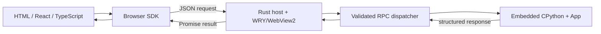

# What is Kourosh.py?

Kourosh.py is a Python-first desktop application framework. You write business
logic and application state in Python, build the user interface with ordinary
browser technologies, and let a Rust host own the native window and WebView2
lifecycle.

The current alpha targets Windows x64. A generated application contains a
Python entrypoint and local frontend assets. The host loads the entrypoint,
reads its explicit method registry, and mediates browser calls through a
bounded JSON protocol.

## Runtime model

Python is the application language. Rust performs native lifecycle work,
origin and method validation, queueing, and transport. The bridge does not
provide arbitrary evaluation, shell access, filesystem access, or a Python
HTTP server.

## What the alpha does not promise

- Linux and macOS desktop GUI support are not release targets for this alpha.
- Windows GUI, WebView2 rendering, installer behavior, signing, and clean
  machine independence require real Windows execution.
- Alpha APIs can change. Avoid private underscore methods and exact diagnostic
  wording in application code.

Read [features](features.md), [supported platforms](platforms.md), and the
[compatibility matrix](../compatibility.md) before selecting the framework for
an application.
